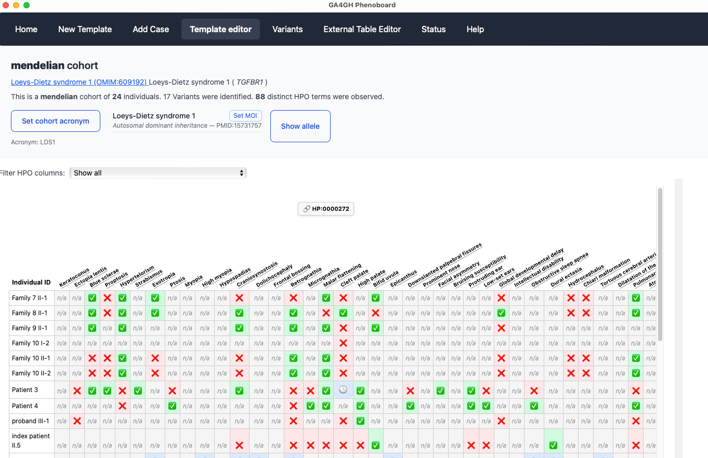
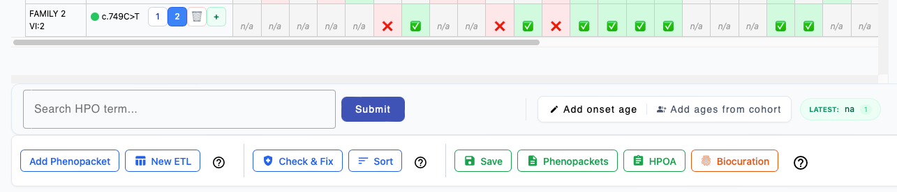

# Cohort editor

This screen allows users to visualize and edit the entire cohort.


<figure>


  <figcaption>
    <strong>Cohort editor</strong>. Functions are provided to edit individual cells. Users may choose to compare the annotations for the case they entered (which will be on the last line), with the annotations for other cases, and if there are important pieces of information that appear to be missing, they can go back to the curated publication and search for them. It is important to curate not only observed features but also explicitly excluded features.
  </figcaption>
</figure>


# Final Review & Submission
After you have entered all of the data for each individual, phenoboard offers several functions to validate the curation data and export to file.

<figure>



  <figcaption>
    <strong>Reviewing curation and export to file</strong>. 
  </figcaption>
</figure>

## Add Phenopacket
Switch to the <i>New Template</i> tab to enter an additional case report to the current cohort.

## New ETL
Switch to the <i>External Table Editor</i> tab to import an additional table of data about individuals to the currrent cohort.

## Check and Fix
Validate the current cohort (it is recommended to perform this step before saving the cohort). Some operations can be performed automatically; for instance, if the only warning is that redundant annotations were found, then phenoboard can correct them automatically.
For instance, if an individual is annotated with [Perimembranous ventricular septal defect 
HP:0011682](https://hpo.jax.org/browse/term/HP:0011682), then according to subsumption logic of ontologies, the individual is implicitly annotated to all of the ancestors of the term. Intuitively, it is easy to see that if an individual has [Perimembranous ventricular septal defect 
HP:0011682](https://hpo.jax.org/browse/term/HP:0011682), then the individual can also be said to have [Ventricular septal defect 
HP:0001629](https://hpo.jax.org/browse/term/HP:0001629), and it is redundant to annotate the latter term. Phenoboard will automatically remove such redundant annotations if the user confirms the message that appears after clicking <i>Check & Fix</i>.

## Sort
If desired, the rows of the cohort can be sorted according to PMID (earliest to latest) using this button.

## Saving cohort

To save a cohort, click on the validate button to check for errors. The ``Sanitize`` button can automatically correct some kinds of errors. If this does not work, the offending table cell(s) will need to be revised. 

## Phenopackets
The ``Phenopackets`` button exports each row of the table as one phenopacket. 

## HPOA
The ``HPOA`` button exports HPO annotations in aggregated tabular format.

## Biocuration
This button adds your ORCID identifier to the cohort export file.

## Cohort configuration

Phenoboard uses an **acronym** for each disease. We prefer the acronyms defined by the [Online Mendelian Inheritance in Man ](https://omim.org/) resource.
For instance, for [Nemaline myopathy 7, autosomal recessive](https://omim.org/entry/610687), the acronym is `NEM7`, and can be found in the title line of each disease entry following the semicolon. In cases in which OMIM does not define an acronym, create an acronym in the same style.

Phenoboard saves the cohort files using a combination of this acronym and the gene symbol. For instance, `PAX3_WS3_individuals.json` has a gene symbol (*PAX3*) and an acronym (`WS3`) for [Waardenburg syndrome, type 3](https://omim.org/entry/148820).

We also need to specify the **mode of inheritance**. We recommend consulting OMIM or the Human Phenotype Ontology for this. Rarely, some diseases have two modes of inheritance (autosomal dominant and recessive, for instance), and in these cases, both should be entered. Phenoboard requires that a PMIM be entered to support the assertion of the mode of inheritance. Users can enter an authoratative citation (e.g., the first description of a disease) or a more recent case or cohort report.


### Sanitize reports "Cannot sanitize automatically"

The ``Sanitize`` button resolves some redundancies. If an individual has both a
general HPO term and a more specific descendant of it marked as observed (for example,
*Abnormal heart morphology* and *Atrial septal defect*), the general term adds nothing to
the phenopacket, so Sanitize changes it to ``na``.

There is one case Sanitize will not resolve automatically. If the general term has an
**age of onset** (for example ``P2Y``), changing it to ``na`` would throw that onset away.
Instead, Sanitize stops, changes nothing, and shows a message like this:

```
Cannot sanitize automatically; fix these by hand (move the onset to the specific
term or remove the redundant term):
Patient 3 (PMID:12345678): 'Abnormal heart morphology' (HP:0001627) has onset 'P2Y'
but is redundant with a more specific term
```

Each line gives the individual, the PMID, the redundant term and its onset. Your cohort
has not been modified, so you can fix the listed cells and try again.

**How to fix each case**

1. Find the individual's row and the term named in the message.
2. Compare it with the more specific (descendant) term in the same row. Decide which
   onset is correct for the finding:
   - **The onset on the general term is the one you want to keep** (for example, the
     first heart problem appeared at 2 years, and the septal defect was diagnosed
     later). Right-click the *specific* term's cell, choose the onset age (add it with
     ``+ New`` if it is not in the list), and confirm with ``OK``.
   - **The specific term already has the right onset**, or the general term's onset was
     entered by mistake. No onset needs to be moved.
3. Right-click the cell of the *general* term, choose ``na``, and confirm with ``OK``.
   A cell set to ``na`` carries no onset or modifiers.
4. Click ``Validate`` and then ``Sanitize`` again. Repeat for any other lines in the message.

::: tip
Sanitize lists every affected cell in one message, so you can fix them all before
trying again.
:::

::: warning
Check the source publication before deciding which onset to keep. Sanitize cannot tell
which one is correct, which is why it leaves this decision to you.
:::